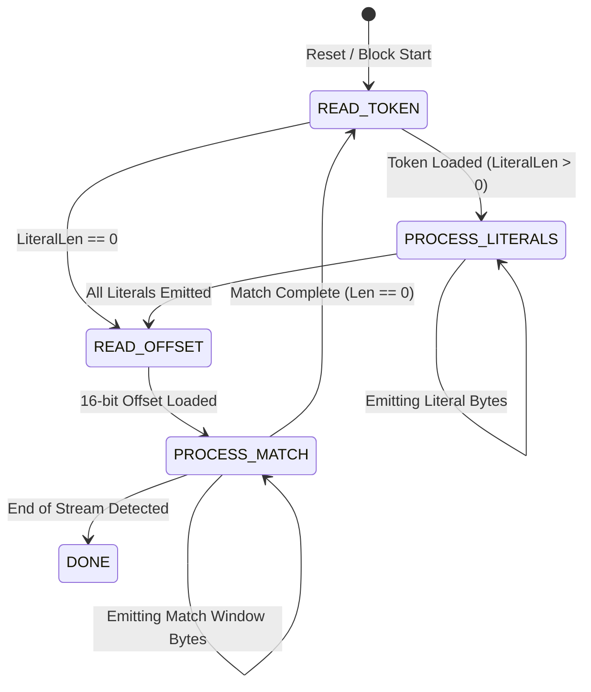

# Pintle Near-Memory Acceleration Subsystem

This document specifies the microarchitecture of the Pintle near-memory hardware acceleration engines: the parallel streaming LZ4 decompressor, the CXL IDE AES-256-GCM cryptographic engine, and the 8-lane SIMD columnar predicate filter.

---

## 1. Near-Memory Acceleration Overview

Modern multi-tenant memory pools suffer from memory bandwidth bottlenecks when large datasets must be transferred over PCIe links to host CPUs purely for decompression, decryption, or basic filtering. Pintle embeds three dedicated compute pipelines adjacent to the DDR5 memory crossbar:

```
             DDR5 Memory Crossbar Read Data (512-bit)
                                 |
         +-----------------------+-----------------------+
         |                       |                       |
         v                       v                       v
+-----------------+     +-----------------+     +-----------------+
|  Streaming LZ4  |     |   CXL IDE AES   |     |   SIMD 8-Lane   |
|   Decompressor  |     |  256-GCM Engine |     | Predicate Filter|
+-----------------+     +-----------------+     +-----------------+
         |                       |                       |
         v                       v                       v
    Decompressed           Decrypted /             Filtered Row
     Cache Lines         Authenticated Data       Bitmask Vector
         |                       |                       |
         +-----------------------+-----------------------+
                                 |
                                 v
                     CXL.mem S2M Ingress FIFO
```

---

## 2. Streaming LZ4 Decompressor

The LZ4 hardware decompressor (`bsv/accel/Lz4Decompress.bsv`) decodes byte streams in accordance with the official LZ4 block framing format at line-rate speeds.

### 2.1 State Machine Microarchitecture



### 2.2 Token Parsing and Match Engine

1. **Token Byte**: The 8-bit token byte is split into two 4-bit nibbles:
   - High 4 bits: Literal length ($L$). If $L = 15$, subsequent bytes are accumulated until a byte $< 255$ is read.
   - Low 4 bits: Match length minus 4 ($M$). If $M = 15$, subsequent bytes are accumulated similarly.
2. **Literal Copy Stage**: Literal bytes are streamed directly from the compressed input FIFO into the output queue. Every emitted byte is simultaneously recorded in a 64KB circular ring buffer (history window).
3. **Match Copy Stage**: The 16-bit match offset ($O$) indexes backwards into the history buffer:
   $$\text{SourceAddr} = (\text{CurrentIndex} - O) \pmod{65536}$$
   The match engine copies $M + 4$ bytes from the history window to the output queue. When offset $O < \text{MatchLength}$ (run-length overlapping repeats), the hardware reads newly written history positions without pipeline bubbles.

---

## 3. CXL IDE AES-256-GCM Cryptographic Engine

Pintle provides hardware security compliant with the CXL IDE (Integrity and Data Encryption) specification using AES-256 in Galois/Counter Mode (GCM) (`bsv/accel/AesGcmCore.bsv`).

### 3.1 Pipeline Structure

The core accepts 128-bit blocks and executes authenticated encryption/decryption in a 14-round iterative architecture:

1. **Key Expansion**: A 256-bit symmetric key is expanded into 15 round keys ($14 \times 128\text{ bits}$).
2. **AES Transform Stage**:
   - `SubBytes`: Parallel non-linear S-box substitution using Galois Field inversion in $GF(2^8)$.
   - `ShiftRows`: Cyclic byte permutation across 4x4 state matrices.
   - `MixColumns`: Linear column matrix multiplication in $GF(2^8)$ with irreducible polynomial $m(x) = x^8 + x^4 + x^3 + x + 1$.
   - `AddRoundKey`: Bitwise XOR with round key.
3. **Counter (CTR) Mode Execution**: Plaintext is XORed with the ciphertext output of the AES core applied to the 96-bit Initialization Vector (IV) and 32-bit counter.

### 3.2 GHASH Authentication Multiplier

Data integrity is authenticated via GHASH:

$$Y_i = (Y_{i-1} \oplus X_i) \cdot H \pmod{P(x)}$$

Where $P(x) = x^{128} + x^7 + x^2 + x + 1$. The 128-bit Galois multiplier utilizes a 4-cycle Karatsuba polynomial tree to achieve line-rate throughput without timing closure degradation at 1 GHz target frequencies.

---

## 4. 8-Lane SIMD Columnar Predicate Filter

To accelerate database scans and tabular analytics, Pintle incorporates an 8-lane SIMD predicate filter (`bsv/accel/StreamFilter.bsv`).

### 4.1 Vector Processing Architecture

Each cycle, the filter consumes an uncompressed 512-bit cache line containing eight 64-bit columnar values:

```
Cache Line Data [511:0]
  +---------+---------+---------+---------+---------+---------+---------+---------+
  | Lane 7  | Lane 6  | Lane 5  | Lane 4  | Lane 3  | Lane 2  | Lane 1  | Lane 0  |
  | [63:0]  | [63:0]  | [63:0]  | [63:0]  | [63:0]  | [63:0]  | [63:0]  | [63:0]  |
  +----+----+----+----+----+----+----+----+----+----+----+----+----+----+----+----+
       |         |         |         |         |         |         |         |
       v         v         v         v         v         v         v         v
    [Comp]    [Comp]    [Comp]    [Comp]    [Comp]    [Comp]    [Comp]    [Comp]
       ^         ^         ^         ^         ^         ^         ^         ^
       +---------+---------+----+----+---------+---------+---------+---------+
                                |
                   Threshold Value [63:0]
                                |
                                v
               Relational Operator [2:0] (EQ, NEQ, LT, LTE, GT, GTE)
                                |
                                v
                    Result Bitmask Vector [7:0]
```

### 4.2 Relational Operators

The comparator in each lane executes one of six relational operations based on a 3-bit mode register:
- `OP_EQ  (000)`: $\text{Lane}_i == \text{Threshold}$
- `OP_NEQ (001)`: $\text{Lane}_i \ne \text{Threshold}$
- `OP_LT  (010)`: $\text{Lane}_i < \text{Threshold}$
- `OP_LTE (011)`: $\text{Lane}_i \le \text{Threshold}$
- `OP_GT  (100)`: $\text{Lane}_i > \text{Threshold}$
- `OP_GTE (101)`: $\text{Lane}_i \ge \text{Threshold}$

### 4.3 Output Aggregation

The resulting 8-bit match vector is accumulated across successive cache lines into a high-density selectivity bitmask. Host queries can retrieve the bitmask directly via CXL.mem read flits, eliminating the need to transfer millions of non-matching table rows across the fabric switch.
