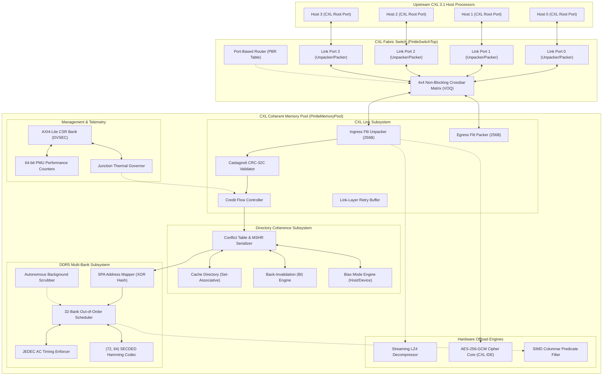

# PINTLE System Architecture

PINTLE is a high-performance, synthesizable Compute Express Link (CXL 3.1) Type 3 Memory Expansion and Coherent Disaggregation Controller implemented in Bluespec SystemVerilog (BSV). It enables multi-host memory pooling, hardware cache coherence with dynamic back-invalidation, multi-bank bank-interleaved DDR5 scheduling, (72, 64) SECDED ECC protection, and inline hardware acceleration (LZ4 streaming decompression, AES-256-GCM CXL IDE encryption, and SIMD columnar predicate filtering).

---

## 1. Top-Level Architectural Overview

PINTLE bridges modern multi-socket, multi-node compute clusters with disaggregated memory tiers over CXL 3.1 standard interconnects. The controller operates over standard 256-byte flits and provides:

1. **Sub-15ns Zero-Copy Link Processing**: Hardware Castagnoli CRC-32C verification, credit accounting, and flit disassembly in a single pipelined cycle.
2. **Directory-Based Cache Coherence**: Distributed hardware directory tracking cacheline sharers across up to 8 independent hosts, eliminating wasteful broadcast snooping over the fabric.
3. **Dynamic Back-Invalidation**: Autonomous invalidation request generator and dirty writeback harvester targeting remote host L2/L3 caches upon conflicting writes.
4. **JEDEC DDR5 Bank Interleaving**: 32-bank out-of-order command scheduler enforcing strict AC timings (tRCD, tRP, tRAS, tWR, tCCD_S, tCCD_L, tWTR) while prioritizing row buffer hits.
5. **Silicon Reliability (SECDED & Scrubbing)**: Per-64-bit (72, 64) Hamming code correcting single-bit soft errors and detecting double-bit fatal corruptions, paired with a low-overhead autonomous background memory scrubber.
6. **In-Memory Acceleration**: Zero-latency streaming LZ4 decompression, line-rate AES-256-GCM CXL IDE encryption, and SIMD columnar predicate filtering for analytics offload.

---

## 2. Multi-Host Fabric Switching (PintleSwitchTop)

The fabric layer implements a 4-port non-blocking crossbar switch (`CrossbarSwitch.bsv`) driven by a Port-Based Routing table (`PortBasedRouter.bsv`).

- **Virtual Output Queues (VOQs)**: Each ingress host port maintains 4 independent channel queues to prevent Head-of-Line (HoL) blocking when one memory channel or downstream device is congested.
- **Round-Robin Fair Arbitration**: 4-way rotating priority arbiters ensure bounded latency and starvation-free egress scheduling across all competing ports.
- **Tenant Isolation**: Hardware partition registers define base and limit addresses per host port. Illegal accesses outside a host partition window are dropped at ingress without impacting other tenants.

---

## 3. Coherence Pipeline & Hazard Serialization

When an incoming CXL.mem request arrives:

1. **Hazard Check**: The System Physical Address (SPA) is checked against the 16-slot Miss Status Holding Register (`ConflictTable.bsv`). If an operation is already pending on the same 64-byte line, subsequent requests stall until the active transaction completes.
2. **Directory Lookup**: The set-associative directory (`CacheDirectory.bsv`) is queried.
   - **Read Hit (Shared)**: Read data is returned immediately.
   - **Read Miss / Device-Bias**: Request is forwarded to the DDR5 scheduler to fetch from memory.
   - **Write Hit (Shared with Peers)**: The Back-Invalidator (`BackInvalidator.bsv`) broadcasts snoop invalidations to all current sharers, waits for acknowledgements, updates the directory to Modified, and commits the write to memory.
   - **Write Hit (Modified by Remote Host)**: Back-invalidator forces the remote host to flush dirty data back to the pool before ownership is granted.

---

## 4. DDR5 Memory Subsystem Datapath

The memory controller decomposes System Physical Addresses using an XOR hash:
- Channel Index: `addr[7:6]` (4 channels)
- Bank Group: `addr[9:8] ^ addr[15:14]` (4 bank groups)
- Bank Index: `addr[12:10] ^ addr[18:16]` (8 banks per group)
- Rank: `addr[13]` (2 ranks)
- Row Address: `addr[31:14]` (256K rows)
- Column Address: `{addr[63:58], addr[5:2]}`

The 32 independent bank queues monitor open row state. When a request matches an open row (Page Hit), column read/write commands issue immediately. When a request targets a closed row (Page Conflict), the timing controller schedules Precharge (tRP) followed by Activate (tRCD) before issuing the column command.

---

## 5. Clocking, Reset, and Power Management

- **Primary Clock**: Link and fabric domain operates at 500 MHz nominal (1.0 GHz DDR equivalent).
- **Synchronous Reset**: Single active-high synchronous reset pin `RST_N` resets all state machines into `IDLE` state within 1 cycle.
- **Thermal Governor**: Junction temperature sensor continuously evaluated. If temperature exceeds 85 C, credit releases are throttled by 50% duty cycle to lower active switching dissipation.
