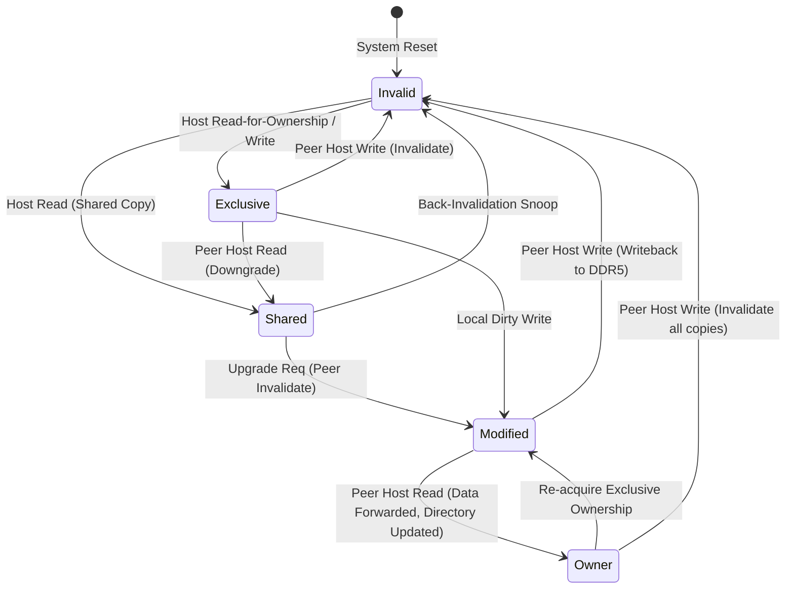

# Pintle Coherence Protocol Specification

This document details the hardware directory-based cache coherence engine implemented in Pintle, covering the MOESI protocol state machine, MSHR conflict resolution, back-invalidation routing, and dynamic bias management.

---

## 1. Coherence Architecture Overview

Pintle provides hardware cache coherence across up to 4 independent host processors sharing a pooled DDR5 physical memory array. Coherence is maintained at 64-byte cache line granularity using a full-map directory structure coupled with a 16-entry Miss Status Holding Register (MSHR) conflict resolution table.



---

## 2. MOESI State Definitions

Every 64-byte cache line tracked in the directory resides in one of five discrete MOESI states:

| State | Name | Description | Host Permissions | DDR5 Memory Status |
| :--- | :--- | :--- | :--- | :--- |
| **I** | Invalid | The cache line is not cached in any host or device agent. | None | Current and clean |
| **S** | Shared | Cached in one or more hosts with read-only permission. | Read Only | Current and clean |
| **E** | Exclusive | Cached exclusively in exactly one host; no modifications yet. | Read / Write | Current and clean |
| **M** | Modified | Cached exclusively in exactly one host and modified (dirty). | Read / Write | Stale |
| **O** | Owner | Cached across multiple hosts; the owner holds the modified copy. | Read Only (Owner forwards) | Stale |

### 2.1 State Encoding

Directory entries represent states with a 3-bit enumeration:
- `DIR_STATE_INVALID   = 3'b000`
- `DIR_STATE_SHARED    = 3'b001`
- `DIR_STATE_EXCLUSIVE = 3'b010`
- `DIR_STATE_MODIFIED  = 3'b011`
- `DIR_STATE_OWNER     = 3'b100`

---

## 3. Directory Entry Organization

The cache directory (`bsv/coherence/CacheDirectory.bsv`) stores metadata for every active physical address line:

```
+------------------------------------------------------------------------+
|                              Directory Entry                           |
+-------------------+--------------------+------------------+------------+
| Tag / Line Addr   | Coherence State    | Sharer Bitmask   | Owner Host |
| (48 bits)         | (3 bits)           | (4 bits: H0-H3)  | (2 bits)   |
+-------------------+--------------------+------------------+------------+
```

- **Tag / Line Addr**: Physical line address bits `[57:6]`.
- **Coherence State**: 3-bit MOESI state.
- **Sharer Bitmask**: 4-bit bitmask where bit $i$ indicates that Host $i$ maintains a valid copy in its local L2/L3 cache.
- **Owner Host**: 2-bit identifier designating which host is responsible for servicing snoops or providing modified data.

---

## 4. Miss Status Holding Register (MSHR) Conflict Table

### 4.1 Hazard Detection

When multiple hosts issue concurrent requests to identical or adjacent cache lines, the memory pool must serialize access to preserve sequential consistency. The MSHR Conflict Table (`bsv/coherence/ConflictTable.bsv`) maintains 16 concurrent transaction records.

Every incoming request checks all 16 slots in parallel via Content-Addressable Memory (CAM) logic:

```
Incoming Request: LineAddr = 0x8000_1040
             |
             +---> Slot 0: 0x8000_0000 (No Match)
             +---> Slot 1: 0x8000_1040 (MATCH! State: ACTIVE_READ) ===> HAZARD DETECTED!
             +---> Slot 2: 0x0000_0000 (Empty)
             ...
             +---> Slot 15: 0x0000_0000 (Empty)
```

### 4.2 Conflict Resolution Policies

1. **Read-After-Read (RAR)**: If an outstanding read is already fetching line $A$ from DDR5, subsequent reads to $A$ merge their requester bitmask into the existing MSHR slot. When the DDR5 data burst returns, both hosts are serviced simultaneously without issuing redundant DRAM reads.
2. **Read-After-Write (RAW)** or **Write-After-Read (WAR)**: If an MSHR slot is already active with an incompatible opcode, the incoming request is stalled in the VOQ or rejected with a `CXL_S2M_RSP_CONFLICT` retry flit, instructing the host to back off with an exponential jitter delay.
3. **Write-After-Write (WAW)**: Strictly serialized; the second write is blocked until the first write completes DRAM commit and directory eviction.

---

## 5. Back-Invalidation Engine

When Host $A$ requests Exclusive access to a cache line currently in state `SHARED` across Hosts $B$ and $C$, Pintle initiates hardware back-invalidation (`bsv/coherence/BackInvalidator.bsv`).

### 5.1 Snooping Workflow

1. **Directory Lookup**: The directory identifies that sharers bitmask is `0b0110` (Hosts 1 and 2).
2. **Snoop Generation**: The Back-Invalidator constructs snoop packets (`CXL_D2H_REQ_INV`) for each sharer except the requesting host.
3. **Rotating Arbiter Dispatch**: Snoops are injected into the egress fabric queues across Virtual Channel 3 (`VC3`).
4. **Invalidation Acknowledgement**: Each peer host invalidates its local cache line and returns an acknowledgement flit (`CXL_H2D_RSP_INV_ACK`).
5. **Directory Upgrade**: Once all outstanding invalidation acks are collected in the MSHR, the directory updates the line state to `EXCLUSIVE` and returns the data payload to Host $A$.

```
Host 0 (Req)         Pintle Controller          Host 1 (Sharer)       Host 2 (Sharer)
     |                       |                         |                     |
     |--- Read-Exclusive --->|                         |                     |
     |                       |--- Back-Invalidate ---->|                     |
     |                       |--- Back-Invalidate -------------------------->|
     |                       |<-- Invalidate Ack ------|                     |
     |                       |<-- Invalidate Ack ----------------------------|
     |<-- Read Data (Excl) --|                         |                     |
```

---

## 6. Dynamic Bias Engine (Device vs Host Bias)

In CXL 3.1 Type 3 accelerator workflows, navigating PCIe links for every cache probe introduces unnecessary round-trip latency. Pintle implements dynamic bias tracking (`bsv/coherence/BiasEngine.bsv`):

### 6.1 Bias Modes

- **Host Bias**: The host CPU maintains primary authority. All device-initiated accesses must issue snoops to the host coherency domain to verify dirty status.
- **Device Bias**: The device controller owns the line exclusively. The device accelerator can read and write the line with zero host snooping latency ($t_{snoop} = 0\text{ ns}$).

### 6.2 Bias Transition Protocol

- **Device to Host**: When a host CPU issues a read to a device-biased line, the Pintle Bias Engine generates a flush snoop to the internal accelerator engines, commits pending writes to DDR5, and flips the bias bit to Host Bias.
- **Host to Device**: Software or DMA descriptors write to the Bias Control CSR, releasing host ownership and allowing high-throughput near-memory accelerators (LZ4 decompressor, AES-GCM engine, SIMD filter) to execute without bus interference.

---

## 7. Deadlock Avoidance and Formal Invariants

Pintle guarantees absence of protocol deadlocks through three structural invariants:

1. **Virtual Channel Ordering**: Requests (`VC1`, `VC2`), Responses (`VC0`), and Invalidation Snoops (`VC3`) run on independent physical FIFO paths. A full response queue never blocks progress on the snoop queue.
2. **Finite MSHR Allocation**: If all 16 MSHR slots are full, incoming non-posted requests are NAKed at the link layer before entering the fabric queues.
3. **Acyclic Dependency Graph**: Snoop completions never depend on DRAM read completions; DRAM read completions never depend on host credit returns.
